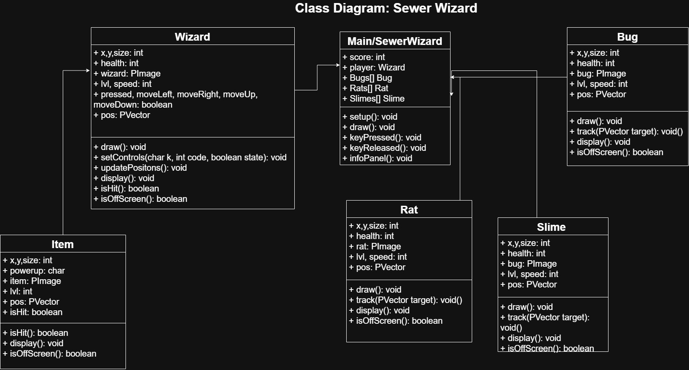
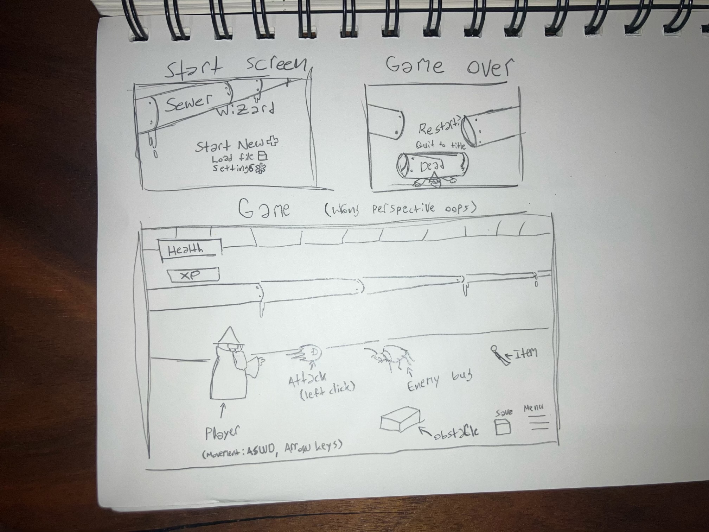

# GameDevGroup2

## Title: Sewer Wizard

## Overview

Our group wants to create a dungeon crawler following a more direct path including puzzles to engage the player along with combat capabilities incorporating timed levels and player based projectiles. The main character is trapped within a dungeon with escape as the main goal in mind. Morality mechanics can also be included. They will fight enemies, defeat puzzles, and create connections with NPCs to reach their final goal. There will be a currency system and health mechanic.

## Pitch Doc
Sewer wizard is a rogue-like, dungeon crawler game following a wizard as the main character. This wizard has been imprisoned within a dungeon and has to shrink himself and adventure to successfully escape. His journey is filled with learning spells to combat enemies, puzzles to engage the user, gaining levels and improved stats, and new items to customize the user experience. This dungeon is filled with NPCs who will help the player throughout the game and various enemies such as rats, insects, spiders, and other fantastical creatures with each dropping items which help the wizard or main character progress through the game. Each level has a final boss with a custom sprite and moveset. The game consists of about 4-5 levels and ends when the main character finally escapes the dungeon.

## Core Action
Adventuring through the dungeon, fighting bosses and various enemies
The dungeon will be organized as room-based generation with treasure rooms, fighting rooms, 

## Design theme
Pseudo-medieval with magic/fantasy elements
Main character: wizard sprite
Enemy: oversized rat and insects sprites, spiders, slimes, and other classical enemies that are or can feasibly be small

## Feedback
Enemies drop useful items for the user to progress. Beating bosses provide useful tools or abilities to the user.

## Challenge
Enemies attack with projectiles and the player must dodge these while being obstructed by obstacles.

[Link to Source Code](https://github.com/Holotech12/GameDevGroup2/tree/main/src)

## How to Run
Built with Processing. Processing version: 4.0.1 Main sketch and project folder: SewerWizard

Required libraries: gifAnimation, Sound

## Class Diagram

## GUI Mockup

